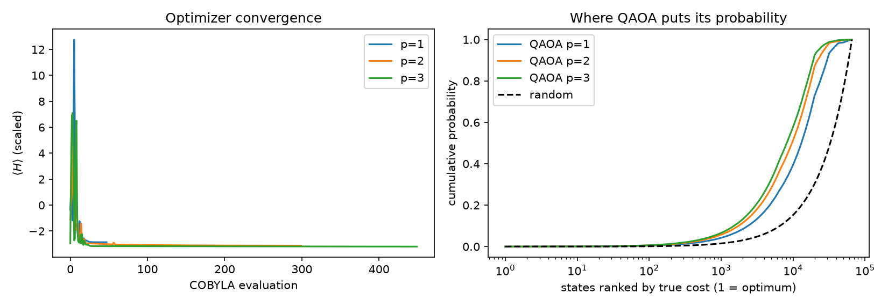
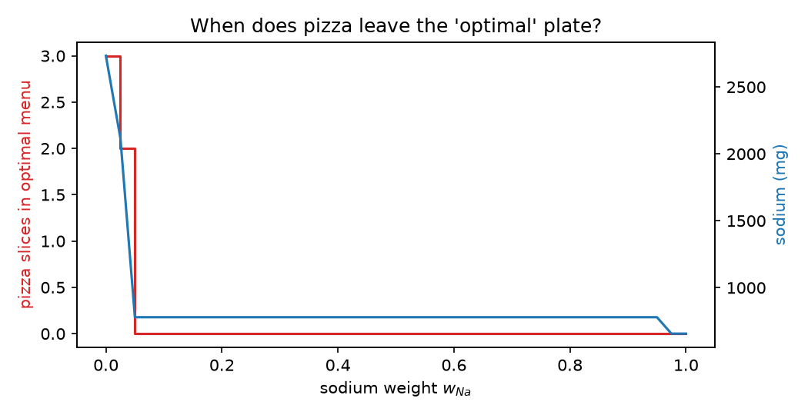

# Match-Day Nutrition with QAOA
**Qompute 2026 · Track 2: Optimizing for People**

How many servings of 8 dining-hall foods should a squash player eat on match day to hit nutrient targets while eating a fixed number of portions? We write that question as a cost function, turn it into a quantum Hamiltonian, solve it with QAOA in Qiskit, and check every answer against brute force.

We then look at the part a solver can't decide for you: **whose priorities set the weights, and what happens to the "optimal" plate when those priorities change.**

> Targets are invented for demonstration. This is not dietary advice.

---

## 1. The scenario and who it affects
A student athlete eats in a dining hall on match day. The menu is fixed, meals are paid with swipes rather than prices, and the decision is how much of each food to take.

We used 8 typical foods: scrambled eggs, oatmeal, chicken, rice, vegetables, banana, peanut butter and pizza. Pizza is included on purpose, to test whether the optimizer keeps it or drops it.

The same kind of tool could be used by a coach, a team nutritionist or a dining-hall planner. Whoever writes the objective decides what "best" means for the athlete.

## 2. Data
Per-serving values come from USDA FoodData Central (SR Legacy), scaled to the serving sizes below.

| Food | Serving | kcal | Protein g | Carbs g | Fat g | Potassium mg | Sodium mg | Source |
|---|---|---|---|---|---|---|---|---|
| Scrambled eggs | 100 g | 149 | 10.0 | 1.6 | 11.0 | 132 | 145 | FDC 172187 |
| Oatmeal, cooked in water | 175 g | 124 | 4.4 | 21.0 | 2.7 | 122 | 7 | FDC 173905 |
| Chicken thigh, roasted | 150 g | 268 | 37.1 | 0.0 | 12.2 | 406 | 159 | FDC 172388 |
| White rice, cooked | 150 g | 195 | 4.0 | 42.3 | 0.4 | 52 | 2 | FDC 168878 |
| Vegetables (broccoli, boiled) | 100 g | 35 | 2.9 | 7.2 | 0.4 | 181 | 13 | USDA SR Legacy |
| Banana | 109 g edible | 97 | 1.2 | 24.9 | 0.4 | 390 | 1 | FDC 173944 |
| Peanut butter | 32 g | 191 | 7.1 | 7.1 | 16.4 | 179 | 136 | FDC 174266 |
| Pizza, pepperoni | 1 slice (108.5 g) | 306 | 12.7 | 34.7 | 12.9 | 212 | 743 | FDC 173295 |

**Assumed targets (invented):** 2600 kcal, 150 g protein, 320 g carbs, 80 g fat, 3000 mg potassium. The macros are consistent with the calories: 4·150 + 4·320 + 9·80 = 2600. Sodium is treated as "less is better," scaled by 2300 mg.

## 3. Formulation
Let nᵢ ∈ {0, 1, 2, 3} be the servings of food i, and aₖᵢ the amount of nutrient k in one serving.

$$
C(n) = \sum_{k} w_k \left(\frac{\sum_i a_{ki} n_i - T_k}{T_k}\right)^2 + w_{Na}\,\frac{\text{sodium}(n)}{2300} + \lambda\left(\sum_i n_i - 14\right)^2
$$

- **Squared relative miss** for each target, so missing above or below both cost something and all units are comparable.
- **Weights wₖ and w_Na** encode what matters. This is a value judgment.
- **Constraint:** exactly 14 servings across the day, added as a **penalty** with strength λ. Choosing λ is also a value judgment.
- **Encoding:** each nᵢ = x₀ + 2x₁ uses 2 bits, so 8 foods × 2 bits = **16 qubits**.
- Expanding the squares gives a QUBO. Substituting x = (1 − Z)/2 gives an **Ising cost Hamiltonian with 16 Z terms and 120 ZZ terms**. Every pair of foods interacts, because they all contribute to the same nutrient totals.

## 4. Method
1. **Brute force** over all 4⁸ = 65,536 menus, giving the exact optimum (0.01 s).
2. `QuadraticProgram` → `QuadraticProgramToQubo` → `to_ising()` in Qiskit Optimization.
3. **Check:** the Hamiltonian's lowest-energy state equals the brute-force optimum.
4. **QAOA** (`QAOAAnsatz`, depth p = 1, 2, 3), circuit simulated exactly with Qiskit Aer. Angles are tuned with COBYLA, starting from a p=1 grid scan and warm-started to deeper circuits.
5. **Sampling** with 4096 shots, compared with uniform random guessing.

### Verification checks built into the notebook
- The Qiskit objective equals our independent numpy cost on random menus (`assert`).
- The Hamiltonian ground state matches brute force (**Match: True**).
- Bit-to-servings decoding agrees with Qiskit's own `interpret` (`assert`).

## 5. Results

### Optimal menus for three "stakeholder" profiles (brute force, exactly 14 servings)
| Profile | Weights | Optimal menu | Sodium |
|---|---|---|---|
| Macros only | equal, sodium ignored | eggs 1, oatmeal 1, chicken 2, rice 3, veg 2, banana 2, **pizza 3** | 2733 mg |
| Performance | protein & carbs ×2, small sodium weight | oatmeal 3, chicken 3, rice 3, banana 3, peanut butter 2 | 779 mg |
| Low sodium | sodium weight 1 | oatmeal 3, chicken 3, rice 3, veg 1, banana 3, peanut butter 1 | 656 mg |

### QAOA vs. random guessing (performance profile)
| | P(optimum) | P(top 1%) | P(exactly 14 servings) | Expected cost |
|---|---|---|---|---|
| Random guess | 0.000015 | 1.0% | 10.3% | 14.99 |
| QAOA p=1 | ~0.00002 | 2.8% | 28.3% | 2.85 |
| QAOA p=2 | 0.0001 | 3.6% | 36.6% | 1.78 |
| QAOA p=3 | 0.0001 | 4.2% | 42.7% | 1.45 |
| Brute-force optimum | | | | 0.077 |

In 4096 shots at p=3, QAOA's best sample was the true optimum, but it was measured only once. QAOA clearly moves probability toward good, feasible menus, and more depth helps. At this depth it does **not** reliably return the single best menu. Exact numbers may vary slightly between runs.



### The pizza test
With macro targets only, the "optimal" plate contains **3 slices of pizza** and 2733 mg of sodium. Pizza's mix of carbs and fat fills the gaps in the targets, and nothing in the objective says sodium is bad. A sodium weight of just **0.025** drops pizza to 2 slices, and **0.05** removes it entirely.



### Penalty strength
With λ ≤ 0.001 the "optimal" menu breaks the 14-serving rule (15–16 servings). From λ ≥ 0.01 the rule holds. A penalty is a price on breaking a rule, not a wall.

### Regret between profiles
| Menu chosen by ↓ / judged by → | macros only | performance | low sodium |
|---|---|---|---|
| macros only | 0 | 0.043 | **0.823** |
| performance | 0.029 | 0 | 0.002 |
| low sodium | 0.080 | 0.045 | 0 |

The pizza-heavy macros-only menu costs a sodium-conscious person about 18 times more than any other mismatch. The performance menu is near-optimal for everyone.

## 6. Reflection: whose optimum?
- **Who chose the objective?** We did, with invented targets for one athlete. A coach, a dietitian or a dining-hall manager would choose different weights and get a different "optimal" plate from the same data.
- **What was left out?** Taste, cost, culture, religion, allergies, meal timing around the match, digestion, and whether the food is even available. Anything not in the objective is treated as worth zero.
- **One missing term can flip the answer.** Leaving sodium out produced a pizza-heavy plate. Adding a tiny weight removed pizza completely.
- **Rules become prices.** The 14-serving rule only held once the penalty was large enough. With a small λ, the optimizer "paid the fine."
- **Risks.** Diet optimizers can encourage rigid or restrictive eating, and "optimal" outputs can look more authoritative than the assumptions behind them deserve. A human, ideally a professional, should own decisions like this.
- **Access.** If quantum optimization ever beats classical methods, the advantage will reach well-funded organizations first. That applies to athletes too: optimized nutrition already favors those with dietitians and good dining options.

## 7. Limitations and an honest classical-vs-quantum comparison
- At 16 qubits, **classical brute force finds the exact optimum in 0.01 s**. QAOA is slower and less reliable here. Better classical solvers (integer programming) would handle hundreds of foods easily.
- The circuit was **simulated** exactly, with no noise and no shot noise during optimization. Real hardware would add gate errors, and each layer needs 120 two-qubit RZZ interactions, which is demanding on current devices.
- Low depth (p ≤ 3) and a coarse angle search limit QAOA's performance.
- QAOA is interesting only for problems too large for exhaustive search, and **no advantage over the best classical solvers has been demonstrated**.
- Targets, weights, serving sizes, the 0–3 serving cap and the 14-serving rule are all assumptions that shape the answer.

## 8. How to run
```
python -m venv .venv
.venv\Scripts\Activate.ps1        # Windows PowerShell
pip install -r requirements.txt
python -m notebook                 # then open nutrition_qaoa.ipynb and Run All
```
Tested with Python 3.12, qiskit 2.5.2, qiskit-aer 0.17.2, qiskit-optimization 0.7.0. A full run takes about 2–15 minutes depending on the machine.

## 9. AI use
We used Claude (Anthropic) as an assistant. It drafted the notebook code and helped with this README, explained the theory, and looked up nutrition values from USDA sources. We chose the problem, the foods and the profiles, reviewed the outputs, and checked them against brute force and the three built-in checks above.

AI mistakes we caught:
- The first version tried to simulate the cost layer as a dense 65,536 × 65,536 matrix and ran out of memory. It was fixed by decomposing the circuit into RZ/RZZ/RX gates.
- A narrowed angle search made QAOA results worse, so it was reverted.

## 10. References
- E. Farhi, J. Goldstone, S. Gutmann, *A Quantum Approximate Optimization Algorithm*, arXiv:1411.4028 (2014).
- Qiskit, Qiskit Optimization and Qiskit Aer documentation.
- B. Tirado, *Track2_challenge_2_tutorial.ipynb* (Max-Cut QAOA), BasQ Qiskit Fall Fest 2026, CC BY 4.0. Our QAOA loop follows its pattern.
- USDA FoodData Central, SR Legacy (FDC IDs in the data table).
