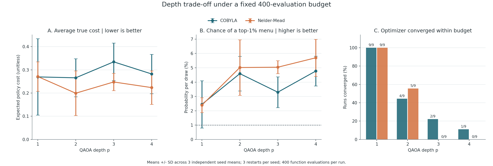
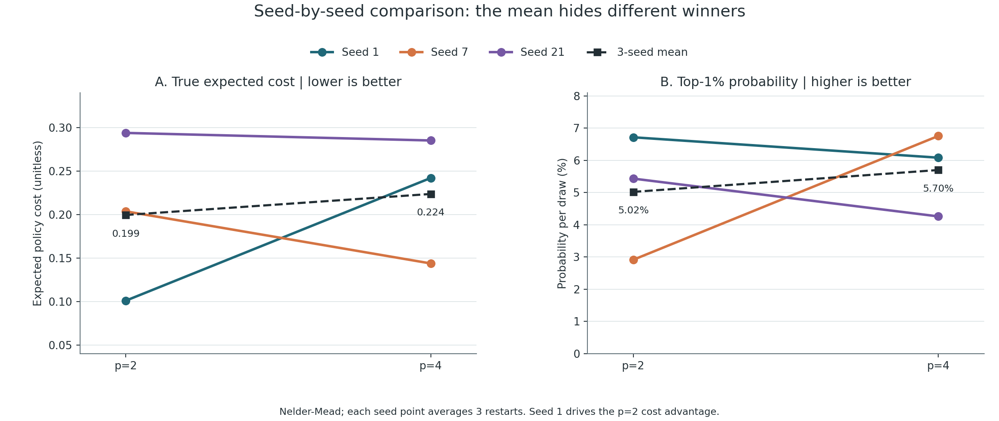
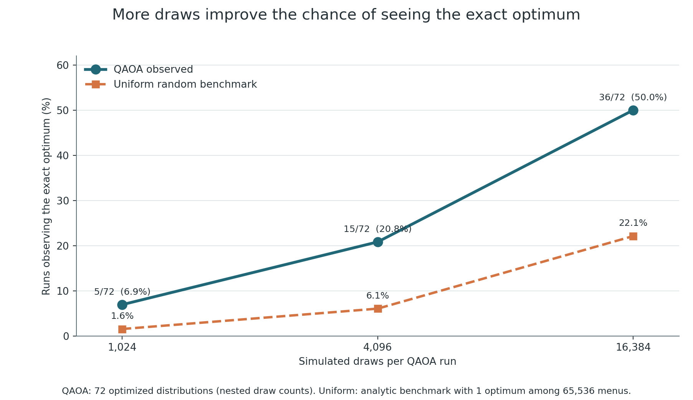
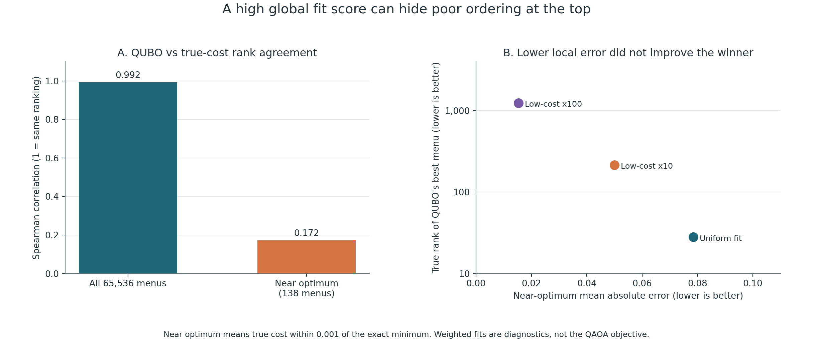

# Nutrition QAOA: experimental results report

**Report date:** October 14, 2026  
**Branch:** `qaoa_new`  
**Completed run:** `20261014T103117_956650Z`  
**Execution:** CPU statevector simulation; no quantum hardware or noise model

## Main findings

The revised experiment completed all **72 QAOA optimizations**, including
depths p=1,2,3,4, two optimizers, three independent seeds, and three restarts.
It demonstrates an executable QAOA workflow and measures its limitations on
a small nutrition-menu problem. It does **not** demonstrate a quantum runtime
advantage over brute force.

**Depth 2 with Nelder-Mead had the lowest average true cost, but depth 4 with
Nelder-Mead had the highest average probability of sampling a high-quality
menu.** These are different performance measures. The depth-2 cost advantage
was strongly affected by one seed, and none of the nine depth-4 Nelder-Mead
runs met the optimizer's convergence criterion within the evaluation budget.

The quadratic approximation is another important limitation: its global rank
correlation is 0.992, but its correlation within 0.001 of the true optimum is
only 0.172. The exact true optimum is not the surrogate's optimum. The study
therefore separates circuit optimization quality, approximation quality, and
the quality of sampled menus under the original objective.

The experiment's recorded elapsed time was **2,866.1 seconds (47.8 minutes)**.
This is one server run, not a portable runtime estimate or a matched timing
comparison against classical solvers.

## Problem and objective

The decision is how many portions to select from eight foods. Each food has
0, 1, 2, or 3 portions, encoded with two binary variables. There are 16 qubits
and **4^8 = 65,536 possible menus**. Total portions are free to vary within
these encoding bounds: there is no fixed total-serving target or penalty.

The true objective minimizes normalized nutrient penalties and rewards food
variety:

```text
true cost = energy penalty + protein penalty + carbohydrate penalty
          + fat penalty + potassium shortfall penalty
          + 0.25 * sodium shortfall penalty + sodium excess penalty
          - 0.02 * (number of selected food types / 8)
```

For nutrient total N, a target T contributes `((N-T)/T)^2`. A range [L,U]
contributes `max(0,(L-N)/L)^2 + max(0,(N-U)/U)^2`. A lower-only reference
contributes `max(0,(L-N)/L)^2`. These are soft penalties, rather than hard
feasibility constraints.

| Quantity | Demonstration setting |
| --- | --- |
| Energy | 2,600 kcal target |
| Protein | 120-180 g |
| Carbohydrate | 280-360 g |
| Fat | 60-100 g |
| Potassium | 3,000 mg lower reference only |
| Sodium | 1,500 mg lower planning reference; 2,300 mg upper reference |
| Diversity | Reward of 0.0025 per distinct selected food |

Selecting two or three portions of an already selected food does not increase
the diversity reward. The reward is represented exactly in the QUBO using
`OR(x0,x1) = x0 + x1 - x0*x1` for each two-bit food encoding. Prices and food
pairing recommendations are not included.

The nutrient values are the project's cached, rounded per-portion dataset,
with FoodData Central source identifiers. They are not a fresh USDA download.
The configuration is an illustrative model, not a validated prescription for
an individual or an athlete population. In particular, the 3,000 mg potassium
reference follows the project configuration. The sodium lower reference is
softly weighted; it is not treated as a proven safety boundary. See the
[model guide and data-source links](nutrition_qaoa_result_public/README.md#data-and-assumptions)
and [exact configuration](nutrition_qaoa_result_public/config.json).

## How QAOA was evaluated

The piecewise nutrient penalties are approximated by a quadratic function of
the 16 binary variables. The diversity term is then added exactly. This QUBO
is converted to an Ising Hamiltonian; the optimizer minimizes its expected
energy by varying the QAOA angles. Scaling the Hamiltonian changes the energy
units but does not remove the approximation error.

The implementation checks QUBO and Hamiltonian energies on 33 representative
states before optimizing. It then computes each optimized circuit's full
statevector probabilities, allowing exact distribution metrics to be
reported separately from simulated measurement outcomes.

| Experimental factor | Values |
| --- | --- |
| QAOA depth | 1, 2, 3, 4 |
| Optimizer | COBYLA, Nelder-Mead |
| QAOA seeds | 1, 7, 21 |
| Restarts | 3 per seed, depth, and optimizer |
| Optimization budget | At most 400 objective evaluations per optimization |
| Number of optimizations | 72 |
| Simulated measurements | 1,024; 4,096; 16,384 per optimized distribution |
| Policy sensitivity | 100 trials with independent +/-10% changes to references and penalty weights |

Summary means first average the three restarts for each seed, then average
the three seed means. Standard deviations are calculated across those three
seed means. They are not confidence intervals. The same seed labels are
used across settings, but random streams also depend on depth and optimizer.

## Exact classical baseline

Brute force evaluates every menu with the true objective. The unique exact
optimum, checked using the project's strict numerical tolerance, has
**17 portions across all eight foods**, zero nutrient penalty, and a diversity
reward of -0.02, giving a true cost of **-0.02**.

| Food | Portions |
| --- | ---: |
| Eggs | 2 |
| Oatmeal | 3 |
| Chicken | 2 |
| Rice | 1 |
| Vegetables | 3 |
| Banana | 3 |
| Peanut butter | 1 |
| Pizza | 2 |

Its nutrient totals are 2,600 kcal, 156.2 g protein, 281.3 g carbohydrate,
99.5 g fat, 3,810 mg potassium, and 2,295 mg sodium. This is an optimum of
the configured finite model. It is not evidence that this exact menu is
nutritionally preferable outside those assumptions.

Source: [baseline_summary.json](nutrition_qaoa_result_public/outputs/runs/20261014T103117_956650Z/baseline_summary.json).

## Depth and optimizer results

Expected true cost measures the average true objective value of a single
measurement from an optimized circuit. Lower is better. Top-1% probability
measures probability mass assigned to the implementation's top-ranked menu
set. Higher is better. Neither is the same as the best menu observed after
thousands of measurements.

| Optimizer | Depth | Expected true cost, mean +/- SD | Top-1% probability | Exact-optimum probability per draw | Optimizer convergence |
| --- | ---: | ---: | ---: | ---: | ---: |
| COBYLA | 1 | 0.2696 +/- 0.1647 | 2.448% | 0.003426% | 9/9 |
| COBYLA | 2 | 0.2658 +/- 0.0820 | 4.592% | 0.009428% | 4/9 |
| COBYLA | 3 | 0.3345 +/- 0.0810 | 3.297% | 0.003994% | 2/9 |
| COBYLA | 4 | 0.2823 +/- 0.0848 | 4.773% | 0.008325% | 1/9 |
| Nelder-Mead | 1 | 0.2713 +/- 0.0633 | 2.393% | 0.003369% | 9/9 |
| Nelder-Mead | 2 | **0.1994 +/- 0.0965** | 5.020% | 0.015980% | 5/9 |
| Nelder-Mead | 3 | 0.2478 +/- 0.0372 | 5.041% | 0.008426% | 0/9 |
| Nelder-Mead | 4 | 0.2235 +/- 0.0724 | **5.698%** | **0.021942%** | 0/9 |

All 72 optimizations produced results. A nonconverged optimizer flag does
not mean that a circuit failed to execute; it indicates that the optimizer
did not satisfy its stopping criterion within the allowed evaluations.



### Why depth 2 appears better on average cost

For Nelder-Mead, comparing the seed means reveals the source of the average:

| Seed | p=2 expected true cost | p=4 expected true cost | Lower cost |
| --- | ---: | ---: | --- |
| 1 | 0.1008 | 0.2419 | p=2 |
| 7 | 0.2036 | 0.1437 | p=4 |
| 21 | 0.2937 | 0.2850 | p=4 |

Depth 4 wins in two of the three seed comparisons, but depth 2's much larger
advantage for seed 1 gives it the lower overall mean. With only three seeds
and substantial variability, this does not establish a reliable depth-2
advantage.

There are also plausible optimization effects. Standard QAOA has 2p angles,
so p=4 optimizes eight parameters under the same 400-evaluation cap used for
p=2's four parameters. None of the depth-4 Nelder-Mead runs converged within
that cap. More circuit layers increase the available circuit family, but
the finite-budget optimizer may not find better parameters. Moreover, better
surrogate energy does not guarantee lower true cost because the objectives
differ. The saved experiment cannot isolate the contribution of each cause.



Source: [aggregate analysis data](output/analysis_data.json), derived from the
saved QAOA summaries.

## Simulated measurement results

Pooling all 72 optimized distributions, the fraction of runs observing the
exact true optimum increased with the number of simulated measurements:

| Measurements per run | Runs observing the exact optimum | Observed fraction | Uniform-sampling benchmark |
| --- | ---: | ---: | ---: |
| 1,024 | 5/72 | 6.94% | 1.55% |
| 4,096 | 15/72 | 20.83% | 6.06% |
| 16,384 | 36/72 | 50.00% | 22.12% |

The uniform benchmark is `1 - (1 - 1/65536)^shots`, since there is one exact
optimum. QAOA measurements are sampled from the statevector probabilities;
these are not observations from a quantum device. Measurement counts use
nested prefixes of each run's sample stream, so the rows are not independent
replications.

These measurements show that the optimized distributions can improve the
chance of encountering a good menu compared with uniform sampling. They do
not account for QUBO fitting, circuit optimization, simulation, or true-cost
postprocessing, so they are not evidence of computational advantage over
brute force or other classical optimizers.



## How much the QUBO approximation matters

The global surrogate has Spearman correlation **0.99197** over all 65,536
menus. However, among the **138 menus within 0.001 of the true optimum**,
its mean absolute error is **0.07853** and its Spearman correlation is only
**0.17178**. Its local error is approximately 78.5 times that near-optimum
window width.

The surrogate's best menu ranks **28th** under the true cost, while the true
optimum ranks **1,008th** under the surrogate. The surrogate's winner still
has a small true-cost gap of **0.00006524**, so exact-rank disagreement should
be reported alongside practical objective differences rather than treated
as the entire result.

Two alternative fits weighted low-nutrition-cost menus more strongly:

| Surrogate fit | Global rank correlation | Near-optimum mean absolute error | True rank of surrogate's winner |
| --- | ---: | ---: | ---: |
| Uniform, used by QAOA | 0.99197 | 0.07853 | 28 |
| Lowest 1% nutrition cost, weight x10 | 0.98982 | 0.05006 | 216 |
| Lowest 1% nutrition cost, weight x100 | 0.98661 | 0.01536 | 1,245 |

Weighting reduced local mean error but worsened the selected winner's true
rank. The weighted fits were diagnostics only; they were not used for the
72 reported QAOA optimizations. This experiment therefore does not support
automatically replacing the original fit with the most heavily weighted fit.



Source: [surrogate validation](nutrition_qaoa_result_public/outputs/runs/20261014T103117_956650Z/surrogate_validation.json)
and [aggregate analysis data](output/analysis_data.json).

## Diversity and sensitivity

The diversity reward is implemented as discussed, but this dataset provides
a weak demonstration of its effect. An all-eight-food menu already achieves
zero nutrient penalty. Positive diversity weights from 0.0025 through 0.1
therefore select the same all-eight-food optimum. There is no meaningful
nutrition-versus-variety trade-off across those tested positive weights.
This does not show that the reward is absent; it shows that this instance
does not stress that part of the objective.

The optimum is also sensitive to the policy settings. Across 100 trials
perturbing nutrient references and penalty weights by +/-10%, the classical
baseline selected **79 distinct best menus**, and the original optimum was
never selected. Food nutrient data and the diversity weight were not
perturbed. The baseline optimum sits near several boundaries, including
99.5 g fat versus a 100 g upper reference and 2,295 mg sodium versus 2,300 mg.
Those facts support presenting a set of good menus and sensitivity results
rather than one universally optimal plate. They do not identify which
individual policy parameter caused each change.

Source: [baseline summary](nutrition_qaoa_result_public/outputs/runs/20261014T103117_956650Z/baseline_summary.json)
and [sensitivity implementation](nutrition_qaoa_result_public/model.py).

## Limitations and next experiments

1. **Small, finite instance.** The study uses eight foods and a 0-3 portion
   encoding, not an unlimited search space. Brute force provides an exact
   answer here. Surrogate fitting itself uses all menus, so the pipeline
   already incurs exhaustive enumeration before QAOA.
2. **Limited independent repetition.** Three seeds are better than one but
   insufficient for a strong conclusion about the best circuit depth. More
   seeds and broader food instances would test whether the ranking persists.
3. **Budget-limited optimization.** Increasing p also increases the angle
   count and circuit cost. A follow-up should compare larger evaluation
   budgets and elapsed time, and test initialization from shallower solutions.
4. **Approximation near the optimum.** An objective redesign should be judged
   by winner quality and near-optimum ranking, not global correlation alone.
   Any revised surrogate requires a new QAOA experiment.
5. **Weak diversity trade-off.** Additional instances should make variety
   compete with nutrient costs, so a weight sweep can measure the effect.
6. **No hardware or scaling result.** The run used CPU simulation. The GPU
   execution path and realistic hardware noise were not validated by this
   result. No claim about large-instance quantum speedup follows from it.

## Published evidence and reproducibility

- [Executed notebook with saved outputs](nutrition_qaoa_result_public/start_here.ipynb)
- [Complete result folder](nutrition_qaoa_result_public/outputs/runs/20261014T103117_956650Z/)
- [Recorded settings](nutrition_qaoa_result_public/outputs/runs/20261014T103117_956650Z/requested_settings.json)
- [Completion status and elapsed time](nutrition_qaoa_result_public/outputs/runs/20261014T103117_956650Z/status.json)
- [Runnable notebook](start_here.ipynb) and [matching upload archive](nutrition_qaoa_extended.tar.gz)
- [Figure inputs](output/analysis_data.json) and [figure generation instructions](output/README.md)

The published snapshot redacts the original username, account, and cluster
identifiers. Scientific result values were retained. The root runnable
notebook has cleared outputs; use the separately linked executed notebook
to inspect the completed run without rerunning it.
